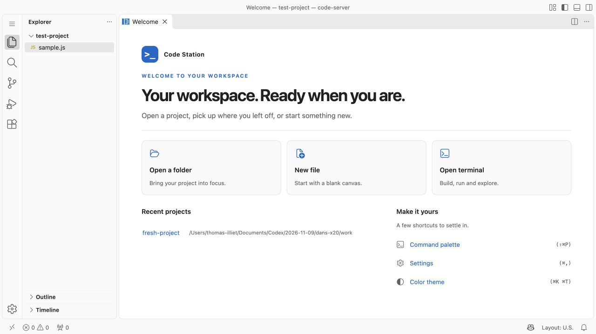

# Code Station — independent patches

An installable [Window Launcher extension](extensions/window-launcher/README.md)
adds **Terminal ↗** and **OpenCode ↗** buttons that open separate windows.
See the [local Docker demo](demo/README.md) to try it with code-server and OpenCode.
The extension is independent of the patches below.

Three standalone patch folders for **code-server 4.145.2**. Each has its own
small application script, source files and documentation. There is **no central
applicator, shared runtime helper or separate configuration file**.

## Apply during the Docker image build

The scripts modify installed files during `docker build`. No running server,
service command or browser connection is needed. Add the desired `COPY` / `RUN`
pairs to your Dockerfile after code-server has been installed:

```dockerfile
USER root

COPY patches/chat/ /tmp/patches/chat/
RUN /usr/lib/code-server/lib/node /tmp/patches/chat/apply.cjs /usr/lib/code-server

COPY patches/logout/ /tmp/patches/logout/
RUN /usr/lib/code-server/lib/node /tmp/patches/logout/apply.cjs /usr/lib/code-server

COPY patches/welcome/ /tmp/patches/welcome/
RUN /usr/lib/code-server/lib/node /tmp/patches/welcome/apply.cjs /usr/lib/code-server

USER 1000
```

This example uses the official 4.145.2 image layout and its runtime user, UID 1000.
Use this repository as the build context. For a different base image, adapt the
installation path and restore its usual runtime user after the `RUN` steps.
The installation directory contains `package.json` and `lib/vscode`; its bundled
Node executable is `lib/node`. No npm installation or VS Code recompilation is needed.

The normal image entrypoint starts code-server when the container is launched.
A failed patch makes its `RUN` step fail. Each script refreshes the browser cache
URL automatically; an already-open tab needs a reload after the new image is deployed.

You can copy **just one feature folder** elsewhere and execute its `apply.cjs`.
It reads its own files relative to that script, not the current working directory.
The other folders and all root files are optional for that operation.

## Apply once, rebuild to change

Each script takes just the installation path. There is no version check, backup,
check-only mode, removal mode or migration mechanism. The JavaScript uses short,
spaced blocks and named intermediate values; readability takes priority over line count.

Apply each selected patch once, sequentially, starting from an unpatched base image.
The only content checks require unique replacement text and one workbench loader.
Applying the same patch twice fails instead of adding duplicate code. To change
or omit a feature, edit its sources or remove its `COPY` / `RUN` pair, then rebuild
from the unpatched base. Other selected patches can keep their Docker build cache.

## Folder guide

```text
patches/
  chat/
    apply.cjs       Standalone application script
    patch.json      Five exact replacements and their explanations
    README.md       Purpose, code walkthrough, limits and Docker example
  logout/
    apply.cjs       Standalone application script
    patch.json      Accounts visibility replacement
    logout.js       Destination URL and gear-menu command
    README.md
  welcome/
    apply.cjs       Standalone application script
    patch.json      Native Welcome renderer hook
    welcome.js      Page texts and behavior; no footer or startup checkbox
    welcome.css     Theme-aware page styles
    README.md
docs/               Operating notes, maintenance and validation report
tests/verify.cjs    Optional integration tests; never used during application
archive/            Previous flat and centralized layouts, for recovery only
```

The short file-edit/cache code is deliberately duplicated. Each feature
can be read, changed, copied and applied without understanding the others.

## Customization and documentation

- [Chat](patches/chat/README.md): top-right Chat/Agents control and Chat pane hidden.
- [Logout](patches/logout/README.md): gear-menu Logout, Accounts icon hidden.
  Edit `logoutUrl` in [logout.js](patches/logout/logout.js) for the destination URL.
- [Welcome](patches/welcome/README.md): Code Station page, without footer.
  Edit `brand` in [welcome.js](patches/welcome/welcome.js) for the name and introduction.

After changing a feature's JS or CSS, rebuild and deploy the image.
Its `COPY` step brings in the changes and its `RUN` step reapplies the patch.
No other patch needs editing. Each feature README explains its exact edits and browser code.

## Compatibility

The reference tested is code-server **4.145.2**; scripts do not read or validate
its version. Matching replacement text alone does not guarantee compatibility
with a different release. Review the affected source and test before upgrading.

Each script refreshes the loader's query string using the resulting bundle hash.
Existing query parameters are replaced. No shared helper, runtime dependency or
extra browser request is added. See the [script walkthrough](docs/APPLICATION.md).

Previously patched images must be rebuilt from an unpatched base to use these
scripts. Older tools remain only in [recovery archives](archive/README.md).


