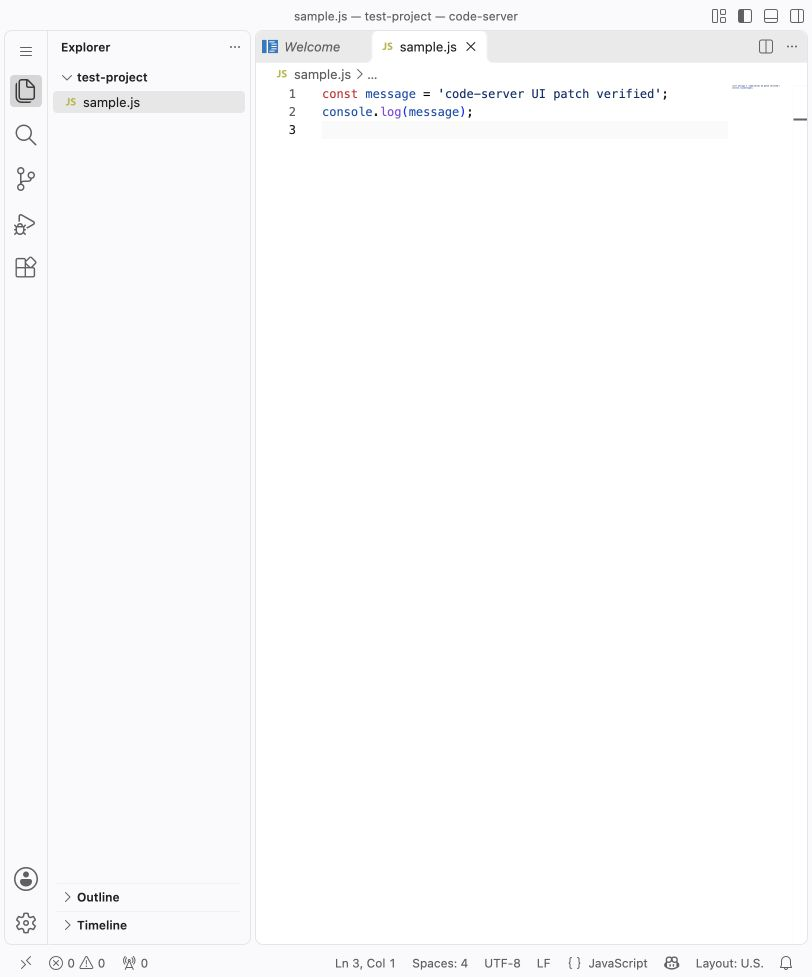

# Chat UI patch

## Purpose

Hide the Chat/Agents control at the top right and the native Chat pane. This is
the requested UI scope; it does not uninstall the Copilot extension or disable
all AI functionality.

## Dockerfile

Add this after installing code-server 4.145.2. Paths and UID below match the
official image; use the repository root as the Docker build context.

```dockerfile
USER root
COPY patches/chat/ /tmp/patches/chat/
RUN /usr/lib/code-server/lib/node /tmp/patches/chat/apply.cjs /usr/lib/code-server
USER 1000
```

Only this folder is needed. The script edits image files during the build, with
no server running. The normal entrypoint starts code-server later. To omit this
patch, remove these steps and rebuild from the unpatched base image.

For direct application to unpatched files, run from this folder:

```sh
node apply.cjs /usr/lib/code-server
```

Apply once. There are no options, backups or version checks. To change the patch,
rebuild from the unpatched base. Reload an open tab after deploying the new image.

## Files to read

- [patch.json](patch.json): the five changes, in execution order. Each entry has
  a `reason`, exact original `before` text and exact replacement `after` text.
- [apply.cjs](apply.cjs): this folder's standalone application script.
  It has no dependency on a root file or another feature. Chat has no browser payload.

The deployment file changed is
`lib/vscode/out/vs/code/browser/workbench/workbench.js`. This folder's script
also changes that script's cache parameter in `workbench.html`.

## Application script walkthrough

The script reads the bundle and iterates the five local replacements. Each must
have exactly one original `before` string and no existing `after` string. Otherwise
the build fails before writes. This catches both changed anchors and repeat application.
No version metadata or whole-bundle checksum is read.

It then requires one HTML loader, replaces its query string with a hash of the
resulting bundle, and writes both files. This cache update makes deployed changes
visible on browser reload. The writes are not transactional; an I/O error fails
the Docker `RUN` step. Fix the error and rebuild; no recovery code runs in the script.

## Explanation of every replacement

| Entry | Native behavior | Patched behavior | Why it is separate |
| --- | --- | --- | --- |
| 1 | Agents/Chat control in the command-center area | Visibility condition becomes `D.false()` | Covers the normal top-right control |
| 2 | Alternative Chat title-bar control | Visibility condition becomes `D.false()` | Covers command center being disabled |
| 3 | Native Chat view registered in its view container | Visibility condition becomes `D.false()` | Includes extension-contributed participants |
| 4 | Alternative Chat Update Requirement view | Visibility condition becomes `D.false()` | Prevents this fallback from leaving a Chat view visible |
| 5 | Restore the last secondary sidebar container | Skip restoration when the container is `workbench.panel.chat` | Prevents an empty Chat sidebar from reappearing on an existing workspace |

`D` is the bundled context-expression helper. `D.false()` keeps the menu/view
registration intact while making its visibility condition false. The fifth
change filters only the Chat container, not other secondary-sidebar views.

Replacement conditions include menu/view context so each match is unique.
Only these exact fragments are changed; no broad replacement of a shared
condition or identifier is performed.

## Boundaries

- No user settings are rewritten.
- The generic secondary-sidebar toggle remains available for other views.
- Copilot extensions, its status-bar entry, Quick Chat and editor actions are
  outside this patch's scope. This is not a security boundary or an AI removal.
- Existing workspace layout state is not deleted. An image rebuilt without this
  patch can show Chat according to normal VS Code behavior and saved preferences.

## Compatibility and upstream locations

Tested reference: official **code-server 4.145.2**. The script does not check the
version. Strings in `patch.json` come from that build, not stable upstream APIs.
This folder can be copied and used independently.

When updating, inspect the bundled registrations containing
`AgentsTitleBarControlMenu`, `ChatTitleBarMenu`, `workbench.action.chat.showUpdateRequired`
and `workbench.panel.chat`. The owning upstream code is under
`src/vs/workbench/contrib/chat/` and `src/vs/workbench/browser/layout.ts`.
Recheck both command-center modes and a workspace that previously had Chat open.

## Validation

The maintained integration suite checks this feature alone, every combination
with Logout/Welcome, all application orders, and rejection of repeated application
or missing/ambiguous text. Browser checks on macOS 4.145.2 verified the title button and
Chat pane hidden, including existing-workspace restoration and command-center
on/off modes. Linux release files were validated; no Linux browser session was run.


