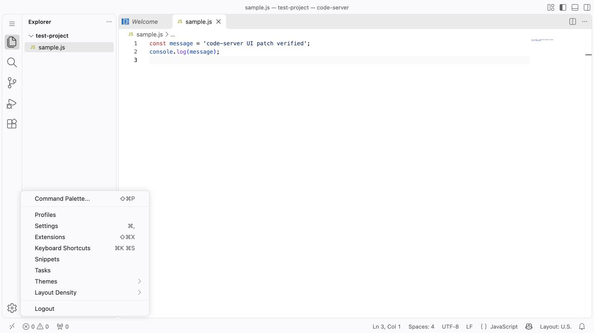

# Logout and Accounts patch

## Purpose

Add **Logout** at the bottom of the **Manage/gear** menu and hide the Accounts
icon. The destination is configured in this folder's own `config.json`.

## Dockerfile

Edit this folder's `config.json` before building. Add these steps after installing
code-server 4.145.2. Paths and UID match the official image; the build context is
the repository root.

```dockerfile
USER root
COPY patches/logout/ /tmp/patches/logout/
RUN /usr/lib/code-server/lib/node /tmp/patches/logout/apply.cjs /usr/lib/code-server
USER 1000
```

Only this folder is needed. No server runs during patching; the script writes
the image's files, and the normal entrypoint starts code-server later. To omit
this patch, remove these steps and rebuild from the unpatched base image.

For direct application to unpatched files, run from this folder:

```sh
node apply.cjs /usr/lib/code-server
```

Apply once. There are no options, backups or version checks. To change the patch,
rebuild from the unpatched base. Reload an open tab after deploying the new image.

## Files and execution contexts

| File | Read by | Responsibility |
| --- | --- | --- |
| [apply.cjs](apply.cjs) | Node.js | Independent build-time application script |
| [patch.json](patch.json) | The local applicator | One exact replacement for Accounts visibility |
| [logout.js](logout.js) | Browser, after embedding in the workbench | Register a command and a gear-menu item |
| [config.json](config.json) | The local applicator | Supply `logoutUrl` |

Do not run `logout.js` with Node. It uses VS Code registries that exist inside the
browser's workbench module. `apply.cjs` embeds it in that module; no additional
browser request, script tag or extension installation is needed.

## Application script walkthrough

The script requires one original Accounts anchor and no patched replacement,
then replaces it in memory. Missing/ambiguous text and repeat application fail
before writes. No version metadata or whole-bundle checksum is read.

It embeds local `config.json` as literal JSON in `logout.js` and appends that
browser code. It requires one HTML loader, replaces its query with a hash of the
final bundle, and writes both files. No URL validation, backup or browser-block
update logic is included. A write error fails the Docker `RUN` step; fix it and
rebuild. Other features' code remains intact.

## Accounts visibility replacement

In this build, `fRt` is the shared `isAccountsActionVisible` helper. Normally it
reads the `workbench.activity.showAccounts` preference through `wj`, the bundled
Accounts activity class. The patch changes its result to `false`.

The preference itself is preserved. Rebuilding an image without this patch restores
the original helper, which then follows the user's stored visibility preference.
While the patch is active, the normal visibility toggle cannot override the
patched result. Account commands and authentication providers remain installed.

## Menu code, step by step

1. `__CODE_STATION_CONFIG__` is substituted with JSON-encoded `config.json` by
   the applicator. Quotes, backslashes and `$&` remain literal data.
2. `Qe.registerCommand` registers `code-server.customLogout`. The ID is distinct
   from the native `code-server.logout`, so the original command is preserved.
3. The handler calls `window.location.assign(config.logoutUrl)`: a same-tab
   navigation, with no network request at menu creation time.
4. `Ae.appendMenuItem` adds the command to `O.GlobalActivity`, the gear menu.
   `group: 'z_logout'` places it after normal settings commands.

The aliases `Qe`, `Ae`, `O`, `fRt` and `wj` are specific to the supported compiled
build. Their upstream roles are CommandsRegistry, MenuRegistry, MenuId,
isAccountsActionVisible and AccountsActivityActionViewItem.

## Configuration and session behavior

Edit `logoutUrl` in [config.json](config.json), then rebuild and deploy the image.
The default is `https://toto.dev.echonet/hub/logout`. Set `logoutUrl` to the desired
absolute HTTP(S) URL. The applicator reads JSON but does not validate the URL.

This works with `--auth none` and external authentication because menu visibility
does not depend on a code-server login. The destination must implement the actual
logout. This patch does not clear code-server password cookies, revoke tokens or
terminate a workspace process. Those are separate authentication/backend concerns.

## Rebuilding and removing

Start from an unpatched base image, including when switching from earlier scripts.
There is no migration or in-place update mode. Changing `config.json` invalidates
the Docker `COPY` layer and reruns this patch from the preceding image layer.
The changed bundle hash refreshes the browser code after deployment and reload.
The loader's previous query parameters are replaced.

To remove Logout and restore normal Accounts behavior, remove this feature's
`COPY` / `RUN` pair and rebuild. Leave other features' steps in the Dockerfile.

## Upstream references and validation

Read `src/vs/workbench/browser/parts/globalCompositeBar.ts` for Accounts and the
gear menu, `src/vs/platform/actions/common/actions.ts` for menu registration,
and code-server's `patches/logout.diff` for its independent native logout command.

Tests cover command registration, exact destination encoding, rejection of repeat
application, standalone operation and all combinations with the other features.
Browser testing on macOS confirmed the gear menu, absent Accounts icon and
same-tab navigation to a local test endpoint. The internal production URL was
not contacted. Linux release-file compatibility was checked without a Linux runtime.


