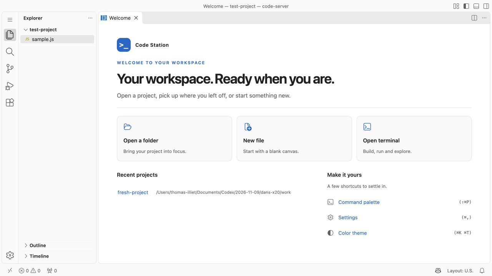
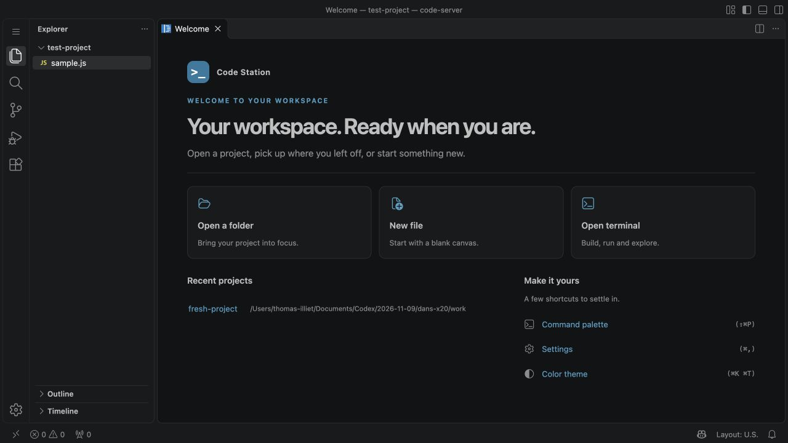

# Code Station Welcome patch

## Purpose

Replace the main Welcome editor with Code Station: an introduction, native
working actions, recent projects and customization shortcuts. Colors follow the
active VS Code theme; the page has no external asset dependency or footer.

## Dockerfile

Edit this folder's text, JS or CSS before building. Add these steps after installing
code-server 4.145.2. Paths and UID match the official image; the build context is
the repository root.

```dockerfile
USER root
COPY patches/welcome/ /tmp/patches/welcome/
RUN /usr/lib/code-server/lib/node /tmp/patches/welcome/apply.cjs /usr/lib/code-server
USER 1000
```

Only this folder is needed. The script writes the image's files during the build;
no running server is needed. The normal entrypoint starts code-server later. To
omit this patch, remove these steps and rebuild from the unpatched base image.

For direct application to unpatched files, run from this folder:

```sh
node apply.cjs /usr/lib/code-server
```

Apply once. There are no options, backups or version checks. To change the patch,
rebuild from the unpatched base. Reload an open tab after deploying the image.
If needed, search for Welcome in the command palette.

## Reading order

1. [apply.cjs](apply.cjs): the independent build-time application script.
2. [patch.json](patch.json): the single hook into the native page renderer.
3. [welcome.js](welcome.js): page texts in `brand`, then DOM, commands and lifecycle.
4. [welcome.css](welcome.css): layout, typography, states and theme colors.

`welcome.js` is browser code. It is not an installation script and should not be
run directly with Node. This folder's applicator embeds both JS and CSS in the
compiled workbench. The deployment needs no extra static-file route.

## Application script walkthrough

The whole folder can be copied and used alone. The script requires one original
renderer anchor and no existing patched hook, then replaces it in memory. Checking
for the patched hook is necessary because it contains the original anchor text.
Missing/ambiguous text and repeat application fail before writes.

It embeds the stylesheet as a JSON-encoded string in the browser function, then
appends that function. The name, headline and introduction are already present
in its `brand` object. Other feature code remains intact.

The script requires one HTML loader, replaces its query with a hash of the final
bundle, and writes JS and HTML. No version check, backup or browser-block update
logic is included. A write error fails the Docker `RUN` step; fix it and rebuild.
To restore native Welcome, remove this feature's steps and rebuild from the base.

The tested reference is 4.145.2. Matching anchors do not establish compatibility
with another release's browser APIs; review this folder on an upstream change.

## How the hook works

The original method starts with `async buildCategoriesSlide(e){`. The patch adds
one early return: call `csRenderCodeStation(this)` when the editor has no selected
walkthrough category. When a category is explicitly selected, execution continues
through the untouched native implementation.

Consequences:

- The main page no longer contains Coder promotion, walkthrough cards or its
  optional agents banner.
- Existing walkthrough commands can still open their native detail pages.
- The patch does not rename the whole product, browser title or Welcome tab.
- It does not customize the code-server login page or authentication flow.

The hook uses named members of the Welcome editor, not the minified local
variables inside its method. It still depends on this version's internal API.

## Page code, section by section

### Page texts and DOM creation

The `brand` object near the start of `welcome.js` contains `name`, `tagline` and
`description`. Edit those JavaScript strings directly. `el()` creates DOM elements
and assigns `textContent`; page text is never parsed as HTML. This also avoids
Trusted Types HTML sinks.

The renderer clears `categoriesSlideDisposables` to release subscriptions from
the previous page before rebuilding it. It creates one `<main>` landmark with
an accessible page label.

### Styles and header

`__CODE_STATION_CSS__` is replaced with a JSON string containing `welcome.css`.
The style element lives inside the categories slide and disappears with it.
Every rule is scoped to `.cs-station`; the `:is(...)` prefix raises specificity
above native Welcome rules without blanket `!important` declarations.

The `>_` brand mark is plain text, not a downloaded logo. Edit `brand` in `welcome.js`
to change the name, tagline or description. Edit the CSS for spacing, colors or shape.

### Working actions and customization shortcuts

`action()` creates a native button, a decorative codicon and its label.
`run()` keeps the Welcome editor open before invoking the VS Code command;
errors are reported through the native notification service.

| Visible action | Native command |
| --- | --- |
| Open a folder | `workbench.action.files.openFolder` |
| New file | `workbench.action.files.newUntitledFile` |
| Open terminal | `workbench.action.terminal.new` |
| Command palette | `workbench.action.showCommands` |
| Settings | `workbench.action.openSettings` |
| Color theme | `workbench.action.selectTheme` |

Displayed keyboard shortcuts are read from the user's current keybindings.
The buttons remain keyboard accessible; the decorative icons are hidden from
screen readers. Adding a new action should use a real native command or a
deliberately implemented handler, not a placeholder link.

### Recent projects

The page reuses `buildRecentlyOpenedList()`, limits the list to five entries and
changes its heading to Recent projects. Opening, removing and loading recent
items remain native behavior. The existing MutableDisposable owns that list.
No project history is duplicated in custom storage.

### Startup preference and lifecycle

The footer and its "Show welcome page on startup" checkbox are intentionally
absent. The renderer does not read or write `workbench.startupEditor`; the user's
existing startup behavior is preserved and can still be changed in normal Settings.

Finally, `replaceChildren()` replaces the categories slide, dispatch listeners
are registered for native recent-list actions, and `setSlide('categories')`
activates it. The native scrollbar is scanned immediately and when the recent
list changes asynchronously. Subscriptions are owned by the page's disposable store.

## Styling and limits

The CSS uses VS Code's foreground, description, button, panel and focus colors.
Native `width-constrained` classes switch the layout to one column in narrow
editors. Focus outlines and high-contrast borders are retained. No remote fonts,
images or analytics requests are introduced.

The page's strings are English. This is not a full localization implementation.
The supplied branding does not include a corporate logo or invented external links.

## Upgrade and validation

The upstream owner is
`src/vs/workbench/contrib/welcomeGettingStarted/browser/gettingStarted.ts`.
On upgrade, inspect `buildCategoriesSlide`, `buildRecentlyOpenedList`,
`registerDispatchListeners`, `setSlide`, the disposable store and scrollbar APIs.
Verify the hook signature and command IDs. There is no version allowlist to update.

Automated checks validate syntax, all patch combinations, rejection of repeat
application, CSS encoding and cache updates. Earlier macOS browser tests
covered light/dark rendering, the six action buttons and recent-project navigation.
The latest revision was checked for the absence of the entire footer and startup
checkbox. Linux files were checked without running
the Linux product. See [test report](../../docs/TESTING.md).




